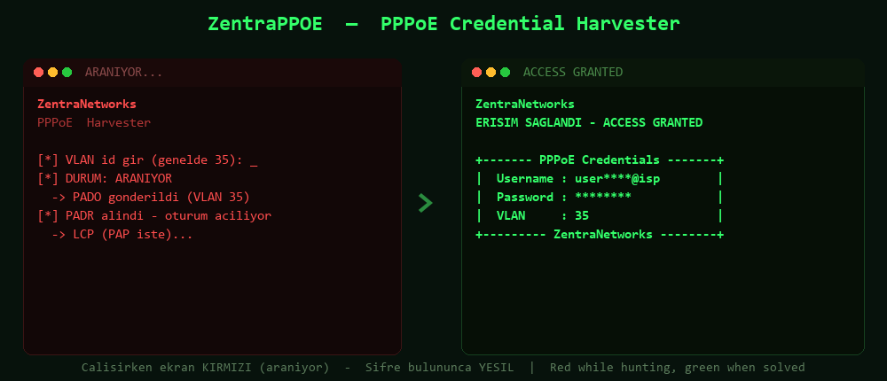

<div align="center">

# ⚡ ZentraPPOE

**Kendi internet hattınızın PPPoE kullanıcı adı ve şifresini modeminizden kurtaran IT aracı.**
**An IT tool that recovers your own line's PPPoE username & password from the modem.**



</div>

---

> 🇹🇷 **Türkçe** · [🇬🇧 English below ↓](#-english)

## 🇹🇷 Türkçe

### Bu nedir, ne işe yarar?

Birçok internet sağlayıcısı (ISP), verdiği modemde **PPPoE şifresini gizler**. Yeni bir
router kurmak ya da modemi köprü (bridge) moda almak istediğinizde bu şifre gerekir ama
elinizde olmaz. **ZentraPPOE**, modem internete bağlanırken giden kimlik doğrulama
bilgisini yakalayarak **kullanıcı adı ve şifreyi size geri verir.**

Normalde bu şifreyi öğrenmek için ISP'nizin çağrı merkezini arayıp **30–40 dakika**
telefonda uğraşmanız gerekebilir — ZentraPPOE bunu **kendiniz, dakikalar içinde** halleder.

> ⚠️ **Yasal uyarı:** Bu aracı **yalnızca kendi hattınızda** veya **yazılı olarak
> yetkilendirildiğiniz** bir hat üzerinde kullanın. Başkasının bilgilerini izinsiz
> ele geçirmek suçtur. Sorumluluk kullanıcıya aittir.

### Nasıl çalışır? (basitçe)

Modem internete bağlanmak için ISP'ye "ben buyum" diye kimlik doğrulaması yapar.
ZentraPPOE, bilgisayarınızı **sahte bir ISP sunucusu** gibi davrandırır; modem bağlanmaya
çalışınca içindeki gömülü kullanıcı adı/şifreyi gönderir ve araç bunu ekrana yazar.
Bazı ISP'lerde trafik bir **VLAN** etiketiyle (çoğunlukla **VLAN 35**) gider — araç bunu
otomatik algılar.

### Neye ihtiyacın var?

- Modeminin **WAN portunu** bilgisayara bağlamak için bir **Ethernet kablosu**
  (bilgisayarında Ethernet yoksa bir **USB–Ethernet adaptörü**).
- **Windows'ta:** [Npcap](https://npcap.com/) (bir kere kurulur).
- Hazır `.exe` kullanıyorsan Python'a gerek yok. Koddan çalıştıracaksan Python 3.8+.

### Kurulum ve Kullanım — 3 yol

#### 🟢 Yol 1: Hazır program (en kolay, Windows)

1. `ZentraPPOE.exe` dosyasını indir (Releases bölümünden).
2. [Npcap](https://npcap.com/)'i kur (bir kere).
3. Modemin **WAN kablosunu** bilgisayarına tak.
4. `ZentraPPOE.exe`'ye **çift tıkla** → **"Evet"** (yönetici izni).
5. Açılan siyah ekranda **VLAN** sorulur: ISP'niz VLAN kullanıyorsa numarasını yaz (genelde `35`), bilmiyorsan **Enter** (otomatik).
6. Modemi **kapat-aç** (veya WAN kablosunu sök-tak).
7. Ekran **kırmızıdan yeşile** döner → kullanıcı adı ve şifre kutuda görünür. ✅

#### 🧰 Yol 2: Python ile (Windows / macOS / Linux)

```bash
# 1) Gerekli kütüphaneyi kur
pip install -r requirements.txt

# 2) Çalıştır (yönetici/sudo şart)
#    Windows (yönetici PowerShell):
python zentra_server.py
#    macOS / Linux:
sudo python3 zentra_server.py
```

Arayüz otomatik seçilir; gerekirse `-i` ile ver. VLAN'ı sorar (`35` ya da boş=otomatik,
`-l 35` ile de verilebilir). Sonra modemi sök-tak → şifre gelir.

#### 📦 Yol 3: Kendin .exe derle

```bash
pip install pyinstaller
pyinstaller --onefile --console --uac-admin --name ZentraPPOE --collect-all scapy zentra_server.py
# çıktı: dist/ZentraPPOE.exe
```

### Sorun giderme

| Sorun | Çözüm |
|-------|-------|
| Ekran kırmızı kalıyor, bir şey gelmiyor | Kablo takılı mı? Link "bağlandı" mı? Modemi sök-tak yaptın mı? |
| `scapy bulunamadı` | `pip install -r requirements.txt` |
| Windows'ta arayüz açılmıyor | Npcap kurulu mu? Yönetici olarak mı açtın? |
| Sadece CHAP görünüyor | Modem CHAP kullanıyordur; şifre hash'li gelir, düz metin olmaz |
| Hiç PPPoE/PADI yok | Modem bu portta PPPoE kullanmıyor olabilir (DHCP/IPoE) |

---

## 🇬🇧 English

### What is this?

Many ISPs **hide the PPPoE password** inside the modem they give you. You need it to set
up a new router or to put the modem in bridge mode — but you don't have it. **ZentraPPOE**
captures the authentication the modem sends when it connects, and **gives you back the
username and password.**

Instead of spending **30–40 minutes** on the phone with your ISP's call center to get it,
ZentraPPOE lets you do it **yourself, in minutes.**

> ⚠️ **Legal notice:** Use this **only on your own line**, or a line you are **explicitly
> authorized** to work on. Capturing someone else's credentials without permission is
> illegal. You are responsible for how you use it.

### How it works (in short)

When a modem connects, it authenticates to the ISP. ZentraPPOE makes your computer act as
a **fake ISP server**; the moment the modem tries to connect, it sends its stored
username/password and the tool prints them. On some ISPs the traffic is tagged
with **VLAN 35** — the tool detects this automatically.

### What you need

- An **Ethernet cable** to connect the modem's **WAN port** to your computer (a
  **USB–Ethernet adapter** if your computer has no Ethernet port).
- **On Windows:** [Npcap](https://npcap.com/) (installed once).
- No Python needed for the `.exe`. For the source, Python 3.8+.

### Install & Use — 3 ways

#### 🟢 Option 1: Ready-made app (easiest, Windows)

1. Download `ZentraPPOE.exe` (from Releases).
2. Install [Npcap](https://npcap.com/) (once).
3. Plug the modem's **WAN cable** into your computer.
4. **Double-click** `ZentraPPOE.exe` → **"Yes"** (admin).
5. It asks for **VLAN**: type your ISP's VLAN number if it uses one (often `35`), or press **Enter** (auto-detect).
6. **Power-cycle** the modem (or re-plug the WAN cable).
7. The screen turns from **red to green** → username and password appear. ✅

#### 🧰 Option 2: With Python (Windows / macOS / Linux)

```bash
pip install -r requirements.txt

# Windows (admin PowerShell):
python zentra_server.py
# macOS / Linux:
sudo python3 zentra_server.py
```

Interface is auto-picked (use `-i` to override). It asks for VLAN (`35` or blank=auto,
or `-l 35`). Then power-cycle the modem → credentials appear.

#### 📦 Option 3: Build the .exe yourself

```bash
pip install pyinstaller
pyinstaller --onefile --console --uac-admin --name ZentraPPOE --collect-all scapy zentra_server.py
```

### Troubleshooting

| Problem | Fix |
|---------|-----|
| Screen stays red, nothing appears | Cable connected? Link "up"? Did you power-cycle the modem? |
| `scapy not found` | `pip install -r requirements.txt` |
| Interface won't open on Windows | Is Npcap installed? Running as Administrator? |
| Only CHAP shown | The modem uses CHAP; the password is hashed, not shown in cleartext |
| No PPPoE/PADI at all | The modem may not use PPPoE on this port (DHCP/IPoE) |

---

<div align="center">

**ZentraPPOE** · MIT License · Yalnızca kendi hattınızda kullanın / Use only on your own line

</div>
